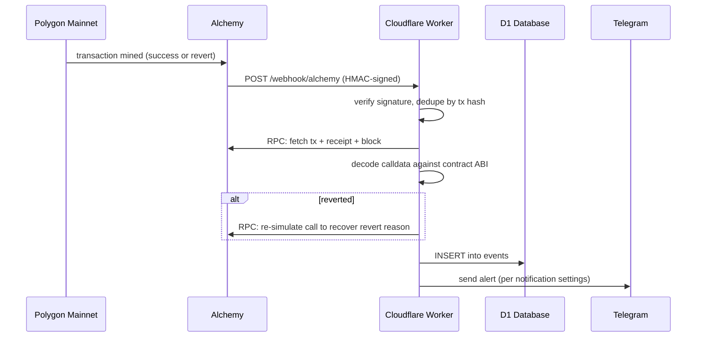
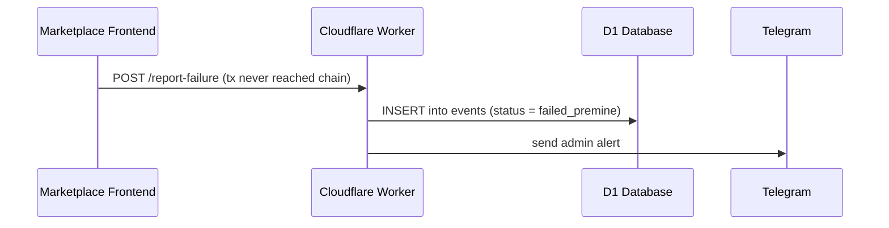
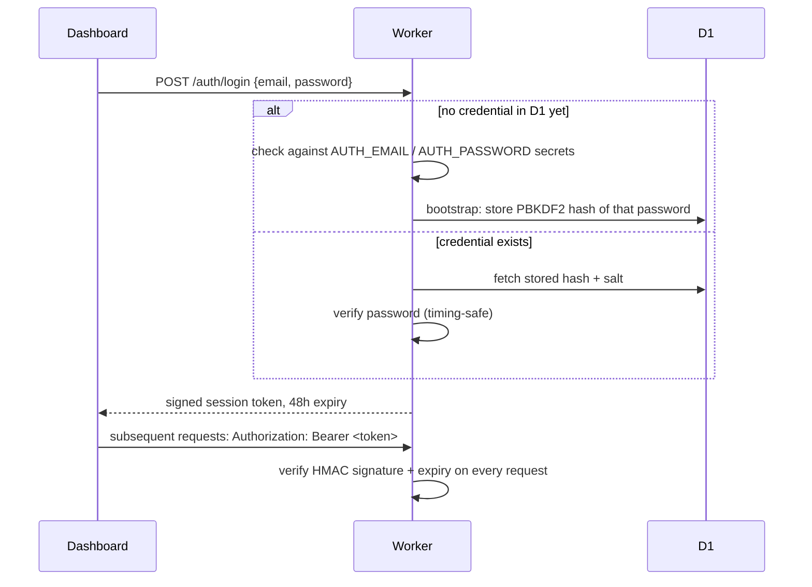
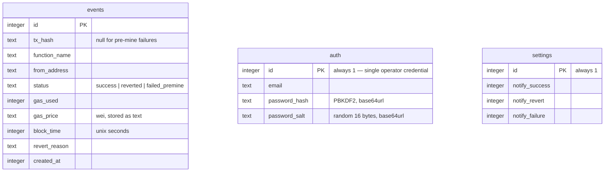

# Contract Monitor — Backend

A Cloudflare Worker that monitors a live smart contract (BorrowLend, on Polygon mainnet) in
real time: it ingests every mined transaction and every pre-mine failure, stores them, sends
Telegram alerts, and serves analytics to the [operator dashboard](https://github.com/Arish0/contract-monitor-frontend).

## Stack

| Layer | Technology |
|---|---|
| Runtime | [Cloudflare Workers](https://developers.cloudflare.com/workers/) (serverless, edge-deployed, no persistent server) |
| Database | [Cloudflare D1](https://developers.cloudflare.com/d1/) (serverless SQLite) |
| Chain data | [Alchemy](https://www.alchemy.com/) Custom Webhooks (mined transactions) + Alchemy RPC (receipts/blocks) |
| Chain decoding | [viem](https://viem.sh/) (ABI decoding, revert-reason re-simulation) |
| Alerts | Telegram Bot API |
| Auth | Custom email/password login, PBKDF2-hashed, HMAC-signed session tokens — no third-party auth provider |
| Language | TypeScript |

## Why a Worker instead of a traditional server

Contract event volume is low and bursty, and the whole thing needs to run for close to nothing.
A Worker has no idle cost, scales to zero, and Cloudflare runs it at the edge closest to whoever
(or whatever webhook) is calling it. D1 is Cloudflare's SQLite-compatible database and lives in
the same platform, so there's no separate database host to manage.

## How data gets in

There are exactly two ways an event is ever recorded — nothing else writes to the `events` table:

1. **Alchemy webhook** (`POST /webhook/alchemy`) — fires when a transaction to the monitored
   contract is mined, success or revert. This is the source of truth for anything that actually
   reached the chain.
2. **Frontend failure report** (`POST /report-failure`) — the marketplace's own frontend calls
   this when a transaction never made it to the chain at all (rejected by the wallet, failed a
   pre-flight simulation, etc). These have no transaction hash, because none was ever assigned.

This split matters: a **reverted** transaction and a **pre-mine failure** are different failure
modes, and it's structurally impossible to catch the second one from the chain alone — the
frontend has to tell us.

## Request flow





## Auth

There's no third-party identity provider — the dashboard is protected by a single operator
credential stored in D1, hashed with PBKDF2 (100,000 iterations, random per-user salt), never
in plaintext.



The `AUTH_EMAIL` / `AUTH_PASSWORD` secrets are only ever used once, to bootstrap the first login.
From then on, the D1-stored credential is authoritative and can be changed via
`POST /auth/change-credentials` (requires the current password).

Session tokens are `base64url(payload).base64url(HMAC-SHA256 signature)` — stateless, no session
store needed, verified by recomputing the signature with `AUTH_SECRET` and checking the embedded
expiry. Every route under `/analytics/*`, `/settings`, and `/auth/change-credentials` requires a
valid token; `/health`, `/auth/login`, `/webhook/alchemy`, and `/report-failure` do not (the
latter two are protected instead by Alchemy's HMAC webhook signature and by simply not exposing
sensitive data).

## Project structure

```
src/
  index.ts              Router — matches method + path, delegates to a handler, nothing else
  types.ts              Env bindings and shared request/response types
  db.ts                 All D1 queries (single source of truth for the schema shape)
  auth.ts               Session tokens + password hashing primitives (HMAC, PBKDF2)
  range.ts              Parses ?range=today|week|month|year|custom into a concrete time window
  http.ts                json() response helper + shared CORS headers
  telegram.ts            Telegram send helper
  verify.ts              Alchemy webhook HMAC verification + tx-hash dedupe (Workers Cache API)
  routes/
    login.ts             /auth/login, /auth/change-credentials, session-guard middleware
    webhook.ts            /webhook/alchemy, /report-failure — the two ways an event is created
  abi/loan-contract-abi.json   Contract ABI, used to decode calldata and revert reasons
schema.sql                D1 schema (events, auth, settings)
```

## Database schema



Nothing is ever deleted from `events` — it's an append-only activity log. At current transaction
volume, D1's free-tier 500 MB-per-database cap is not a realistic constraint for years.

## API reference

All routes return JSON and are CORS-open (`Access-Control-Allow-Origin: *`); protected routes
additionally require `Authorization: Bearer <token>`.

| Method | Path | Auth | Description |
|---|---|---|---|
| GET | `/health` | — | Liveness check |
| POST | `/auth/login` | — | `{email, password}` → `{token, expiresAt}` |
| POST | `/webhook/alchemy` | Alchemy HMAC signature | Alchemy Custom Webhook target |
| POST | `/report-failure` | — | `{fn, user, reason, stage}` — pre-mine failure report |
| POST | `/auth/change-credentials` | ✅ | `{currentPassword, newEmail, newPassword}` |
| GET | `/analytics/summary` | ✅ | Totals + revert rate + avg gas for the selected range |
| GET | `/analytics/traffic` | ✅ | Calls per hour, for the traffic chart |
| GET | `/analytics/gas` | ✅ | Gas used per hour |
| GET | `/analytics/by-function` | ✅ | Call/revert/failure counts grouped by contract function |
| GET | `/analytics/top-wallets` | ✅ | Most active wallets |
| GET | `/analytics/heatmap` | ✅ | Call volume by day-of-week × hour-of-day |
| GET | `/analytics/events` | ✅ | Paginated transaction list (`?limit=&offset=`) |
| GET | `/settings` | ✅ | Current Telegram notification toggles |
| POST | `/settings` | ✅ | Patch notification toggles |

All `/analytics/*` routes accept `?range=today\|week\|month\|year\|custom` (custom also takes
`from`/`to` as unix seconds).

## Environment variables

Non-secret config lives in `wrangler.toml` under `[vars]`. Secrets are never committed — set them
with `wrangler secret put <NAME>` (production) or a local `.dev.vars` file, gitignored, copied from
[`.dev.vars.example`](.dev.vars.example):

| Variable | Purpose |
|---|---|
| `CONTRACT_ADDRESS` | Monitored contract address *(non-secret, in wrangler.toml)* |
| `ALCHEMY_NETWORK` | Alchemy network slug, e.g. `polygon-mainnet` *(non-secret)* |
| `EXPLORER_TX_BASE_URL` | Block explorer base URL for tx links *(non-secret)* |
| `TELEGRAM_BOT_TOKEN` | Telegram bot token |
| `TELEGRAM_ACTIVITY_CHANNEL_ID` | Where success alerts are posted |
| `TELEGRAM_ADMIN_GROUP_ID` | Where revert/failure alerts are posted |
| `ALCHEMY_API_KEY` | Alchemy RPC key (fetching tx/receipt/block details) |
| `ALCHEMY_SIGNING_KEY` | Verifies the Alchemy webhook's HMAC signature |
| `AUTH_EMAIL` / `AUTH_PASSWORD` | Bootstrap login credential — only used for the very first login, superseded by D1 afterward |
| `AUTH_SECRET` | HMAC key that signs session tokens |

## Local development

```bash
npm install
cp .dev.vars.example .dev.vars   # fill in real values
npm run dev                       # wrangler dev, http://localhost:8787
```

## Deployment

```bash
npm run deploy                    # wrangler deploy
npm run db:migrate                # apply schema.sql to the remote D1 database
```

Secrets are set once per environment and persist across deploys:

```bash
wrangler secret put TELEGRAM_BOT_TOKEN
wrangler secret put AUTH_SECRET
# ...etc, one per secret listed above
```
